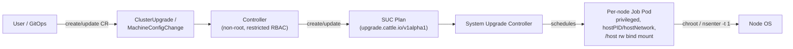

# Security Analysis: Cluster Management Controllers

This document analyzes the security posture of the two Kubernetes controllers that `bootc-mke3` uses to automate cluster lifecycle operations. It also lists specific mitigations. The analysis uses the upstream repositories of both controllers at the commits below. This repository does not vendor them.

| Controller | Upstream | Commit analyzed |
|---|---|---|
| cluster-upgrade-controller | `git@github.com:Mirantis/cluster-upgrade-controller.git` | `8d37c8d` (2026-07-16) |
| machine-config-controller | `git@github.com:Mirantis/machine-config-controller.git` | `6b2b670` (2026-07-16) |

## How to re-run this analysis

The controllers are no longer vendored into this repository. To check a claim in this document again, clone the two upstream repositories at (or near) the pinned commits above: `cluster-upgrade-controller` @ `8d37c8d` and `machine-config-controller` @ `6b2b670`. Then check the cited files and line ranges directly in those checkouts.

> [!IMPORTANT]
> Both controllers depend on [Rancher's System Upgrade Controller (SUC)](https://github.com/rancher/system-upgrade-controller). SUC is *not* vendored here, and source review of SUC is out of scope. Its trust model is central to the security of both controllers. This document analyzes the trust model from the way the controllers invoke and configure SUC (`ansible/tasks/suc-priv-grant-tasks.yml`, `ansible/tasks/cluster-upgrade-controller-tasks.yml`).

## 1. Shared architecture and trust model

Neither controller changes the state of a node or host directly. Both controllers use the same pattern:

- The **in-cluster controller pods** have low privilege. They run as non-root (UID 65532), set `allowPrivilegeEscalation: false`, drop all Linux capabilities, and use distroless base images with no shell.
- All privileged work occurs in **SUC-scheduled Job Pods**, one for each matched node. These Pods run with `privileged: true` and the host PID and network namespaces. They have a read-write bind mount of the host root filesystem at `/host`. Scripts in these Jobs use `chroot /host …` or `nsenter --target 1 …` to run commands directly in the root and PID-1 namespace of the node.
- **Consequence**: a user who can create or edit the CR that drives a controller (`ClusterUpgrade` or `MachineConfigChange`) has **root-equivalent access to every node that the Plan targets**. A user who can create or edit the resulting `Plan` in the `system-upgrade` namespace has the same access. The machine-config-controller project states this clearly:

  > "Creating a `MachineConfigChange` is cluster-root-equivalent on every node it matches — the generated SUC `Plan` runs a privileged, host-PID, host-root-mounted job per node. RBAC `create` on this CRD should be treated like `cluster-admin`."
  > — [`README.md#L17-L23`](https://github.com/Mirantis/machine-config-controller/blob/6b2b670/README.md#L17-L23), [`docs/reference.md#L3-L7`](https://github.com/Mirantis/machine-config-controller/blob/6b2b670/docs/reference.md#L3-L7)

  The same reasoning applies to the `ClusterUpgrade` CRD of `cluster-upgrade-controller`. It drives `bootc switch`, Docker daemon reconfiguration, and MKE3/MKE4 upgrade scripts through identical SUC Plans.

- **RBAC on the CRDs is therefore the primary security boundary.** RBAC on the ServiceAccounts of the controllers is not the primary boundary, because it is already tightly scoped (see below).

## 2. cluster-upgrade-controller

**Purpose**: orchestrates OS (`bootc`), MKE3, and MKE4 upgrades for the whole cluster through a single `ClusterUpgrade` custom resource.

### 2.1 RBAC footprint

Source: [`config/rbac/role.yaml#L1-L116`](https://github.com/Mirantis/cluster-upgrade-controller/blob/8d37c8d/config/rbac/role.yaml#L1-L116) (mirrored in `chart/cluster-upgrade-controller/templates/rbac.yaml`), bound cluster-wide via `ClusterRoleBinding` to the `cluster-upgrade-controller` ServiceAccount.

| API group | Resource | Verbs | Purpose |
|---|---|---|---|
| `` (core) | `namespaces` | get, list, watch | check that `system-upgrade` exists |
| `` (core) | `nodes` | get, list, patch, watch | read node roles and patch `mke/version` label |
| `coordination.k8s.io` | `leases` | full CRUD + watch | leader election |
| `events.k8s.io` | `events` | create, patch | progress/failure events |
| `helm.k0s.k0sproject.io` | `charts` | get, list, watch | check MKE4 component rollout |
| `kcm.k0rdent.mirantis.com` | `managements` | get, patch, update | trigger k0rdent cluster template rollout |
| `mke.mirantis.com` | `mkeconfigs` | get, list, patch, update, watch | patch MKE4 target version |
| `mke.mirantis.com` | `mkereleases` | create, get, list, patch, update, watch | manage MKE4 release CRs |
| `upgrade.cattle.io` | `plans` | full CRUD + watch | **create/manage SUC Plans — the privileged escalation point** |
| `upgrade.mirantis.com` | `clusterupgrades`(`/status`,`/finalizers`) | full CRUD + watch | own CRD lifecycle |

The `plans` grant is the key entry. It is how a low-privilege controller pod causes SUC to schedule privileged Jobs that change the host. The controller pod itself does not run privileged.

### 2.2 Pod/container hardening (already in place)

- `runAsNonRoot: true`, UID/GID 65532 — `chart/cluster-upgrade-controller/values.yaml:19-22`
- `allowPrivilegeEscalation: false`, `capabilities.drop: [ALL]`, `readOnlyRootFilesystem: true` — `values.yaml:24-29`
- Base image `gcr.io/distroless/static:nonroot`, no shell — `Dockerfile:1-14`
- No `hostNetwork`/`hostPID`/`hostPath` on the controller Deployment itself — `chart/cluster-upgrade-controller/templates/deployment.yaml`

### 2.3 What the generated Plans actually do on nodes

| Step (CRD field) | Script / action | Attacker-influenced input |
|---|---|---|
| `bootc-os` (`spec.os`) | `chroot /host bootc switch "$TARGET"`, then `nsenter -t 1 … systemctl --no-block reboot` — `internal/suc/plan.go:99-108` | `spec.os.image` (OCI ref, pattern-validated: `^[A-Za-z0-9][A-Za-z0-9._/:@-]*$`) |
| `mke3-upgrade` (`spec.product.mke3`) | `docker run mirantis/ucp upgrade --id <id> $MKE3_UPGRADE_FLAGS` against the host Docker socket | `spec.product.mke3.image`, `upgradeFlags` (**no pattern validation** — `internal/step/mke3_upgrade.go`) |
| `mke3-docker-config` | decode `DOCKER_DAEMON_CONFIG_B64`, write `/etc/docker/daemon.json`, `systemctl --no-block restart docker` | `spec.product.mke3.dockerDaemonConfig` (raw JSON, validated only for JSON syntax, not content) |
| `mke3-backup` | `docker run mirantis/ucp:<current> backup` → tar to host path | `spec.product.mke3.backupDir` (pattern-validated: `^/[A-Za-z0-9._/-]*$`) |
| `etcd-maintenance` | runs `/upgrade-etcd-maint.sh` from an OCI artifact on control-plane nodes | `spec.product.mke4.etcdMaintenance{Image,ArtifactRef}` |
| `mke`/`k0rdent` | patches `MkeRelease`/`Management` CRs. No direct node script | version strings only |
| `mke3-controllers-upgrade` (`spec.product.mke3.controllersUpgrade`) | **Not a SUC Plan** — a plain `batch/v1` Job running the controller's own image as `/manager apply-manifests`, Server-Side-Applying `system-upgrade-controller-crd.yaml`, `system-upgrade-controller.yaml`, `machine-config-controller-manifest.yaml`, `cluster-upgrade-controller-manifest.yaml` from a node hostPath (`cluster-upgrade-controller/internal/manifestapply/apply.go`) with `Force: true` and `FieldManager: cluster-upgrade-controller` | Only a bool (`enabled`) and an admission-pattern-validated path (`manifestsDir`). The manifests that it applies are content that the image already contains, not content that the spec supplies. The controllable surface here is "whether this runs," not "what it applies" |

The blast radius of `mke3-controllers-upgrade` is qualitatively different from every
other row. The reason is not that it is the only step that touches the
Kubernetes API. The `mke`/`k0rdent` row patches `MkeRelease`/`Management`
CRs, which is also an API write. The difference is scope. Every other step that
writes to the API changes *custom resources*, and a controller then acts on
them. This step directly replaces cluster-scoped **CRDs, RBAC and Deployments**.
It is also the only step that replaces the identity
(ServiceAccount/RBAC) of the controller that runs it. It also replaces the
identity of SUC, the controller that the Plans of every other step depend on.
`Force: true` SSA overwrites any manual or Helm-managed changes to the objects
of these three controllers. The field ownership is `cluster-upgrade-controller`.
This is relevant if an operator manages any of the three controllers
out-of-band. See the callout on `controllersUpgrade.enabled` in the
[upgrade runbook](upgrade-with-controller.md#2-apply-the-clusterupgrade-cr).

### 2.4 Secrets, network, logging

- The controller does not read application secrets directly. It uses only its in-cluster ServiceAccount token.
- `dockerDaemonConfig` can contain registry credentials that the user embeds. The controller stores it as plain CRD spec text (not a `Secret`). Anyone with `get` on `ClusterUpgrade` objects can read it. It appears in etcd unencrypted unless you enable [encryption at rest](harden-mke3-kubernetes.md#7-enable-etcd-encryption-at-rest).
- Metrics (`:8080/metrics`) and health (`:8081/healthz`,`/readyz`) are plain HTTP and **require no authentication**. By default they are available only on ClusterIP (`cmd/main.go:29-53`, `chart/cluster-upgrade-controller/templates/deployment.yaml:35-53`). There is no admission webhook server.
- By default, logging uses `zap` in development mode (`cmd/main.go:39-40`). It is verbose, but it is not a security issue in itself. We recommend `Development: false` in production to prevent stack traces from leaking.

## 3. machine-config-controller

**Purpose**: applies OS-level machine configuration (DNS resolvers, NTP, kernel `sysctl`) to nodes through the `MachineConfigChange` CRD.

### 3.1 RBAC footprint

Source: kubebuilder markers in `internal/controller/machineconfigchange_controller.go:64-69`, rendered to `charts/machine-config-controller/templates/{clusterrole,role,leader-election-role}.yaml`.

| Scope | API group | Resource | Verbs |
|---|---|---|---|
| Cluster | `config.machine-config-controller.io` | `machineconfigchanges`(`/status`) | get, list, watch, update, patch |
| Cluster | `` (core) | `events` | create, patch |
| Namespaced (`system-upgrade` by default) | `` (core) | `secrets` | get, list, watch, create, update, patch, **delete** |
| Namespaced | `` (core) | `serviceaccounts` | get, list, watch |
| Namespaced | `upgrade.cattle.io` | `plans` | get, list, watch, create, update, patch, delete |
| Namespaced | `coordination.k8s.io` | `leases` | full CRUD (leader election) |

The escalation shape is the same as in `cluster-upgrade-controller`. The controller cannot touch a node itself, but its `plans` grant lets it cause SUC to schedule a privileged Job on each matching node. The `secrets` grant (including `delete`) applies only to the target namespace, which is reasonably tight. But that namespace is also the namespace where SUC runs privileged Jobs. Namespace-level access control is therefore important (see §5).

### 3.2 Pod/container hardening (already in place)

- Controller: `runAsNonRoot: true`, `seccompProfile: RuntimeDefault`, `allowPrivilegeEscalation: false`, `capabilities.drop: [ALL]` — `charts/machine-config-controller/machine-config-controller/values.yaml:43-51`. The base image is `distroless/static:nonroot`, UID 65532 — `Dockerfile:10-13`.
- A **second image**, `Dockerfile.agent` (Alpine 3.20, digest-pinned), runs only inside SUC Job Pods. It runs as root, with the packages (`bash`, `jq`, `util-linux`) that the host-mutation scripts need. This is normal, because it is the privileged half of the design. But the "agent" image is a second supply-chain surface that runs as root. You must pin it and scan it in the same way as the controller image.

### 3.3 What the generated Plans actually do on nodes

`apply.sh` (`internal/scripts/apply.sh:1-20`) dispatches every module from a per-CR `Secret` that the Job mounts. **No module has semantic allowlisting beyond syntax**:

| Module | Script | Effect | CRD validation |
|---|---|---|---|
| `network` | `internal/scripts/network.sh:6-52` | Overwrites `/host/etc/resolv.conf` with attacker-supplied nameservers/search domains | none beyond string type |
| `ntp` | `internal/scripts/ntp.sh:6-36` | Overwrites `/host/etc/systemd/timesyncd.conf` and runs `nsenter --target 1 … systemctl enable --now systemd-timesyncd` | none beyond string type |
| `kernel` | `internal/scripts/kernel.sh:6-59` | Writes `/etc/sysctl.d/90-machine-config-controller.conf` and runs `nsenter --target 1 … sysctl --system` | CEL regex requires dotted key syntax (`^[a-zA-Z_][a-zA-Z0-9_]*([.][a-zA-Z0-9_-]+)+$`) and rejects control characters in values. **No allowlist of which sysctl keys are safe**: for example, `kernel.core_pattern`, `kernel.modules_disabled`, `net.ipv4.ip_forward` are all settable |

`apply.sh` also does not validate which top-level `config.json` keys map to which script. It runs any `<key>.sh` that is present. The blast radius is therefore limited only by the scripts that the agent image contains today.

Existing mitigation: before the controller creates the Plan, it checks that `spec.rollout.serviceAccountName` (default `system-upgrade`) exists. This prevents SUC from pointing at an arbitrary or nonexistent SA (`internal/controller/machineconfigchange_controller.go:229-234, 314-319`). Each managed file has one backup (`*.mcc-orig`) as a manual revert path. There is **no automatic rollback** on failure.

### 3.4 Secrets, network, logging

- The controller writes the full rendered script bundle **and** `config.json` into a `Secret` for each CR (`internal/controller/machineconfigchange_controller.go:182-212`). It is plaintext at rest in etcd if encryption at rest is not enabled. Anyone with `get secrets` in the target namespace can read it.
- The metrics (`:8080`) and health (`:8081`) endpoints require no authentication, as in cluster-upgrade-controller (`cmd/main.go:33-37`, `charts/.../templates/deployment.yaml:28-46`).
- There is no admission webhook. All validation uses only the CRD schema (CEL/regex).

## 4. Cluster-wide risk factors introduced at install time

The Ansible tooling in this repository grants wider privileges than the controllers need, to make SUC work. It does this **unconditionally whenever `deploy_suc: true`** (the default):

- `ansible/tasks/suc-priv-grant-tasks.yml` adds `system-upgrade:system-upgrade` to the MKE `UCPAuthorization` allowlist for `privileged, hostIPC, hostNetwork, hostPID, hostBindMounts, kernelCapabilities`. This grant is correctly scoped to the SUC service account.
- The same task also sets **`enable_admin_ucp_scheduling = true`** for the whole cluster. This lets **all authenticated users and service accounts** (not only SUC) schedule pods on manager and MSR nodes. This is wider than SUC needs. It increases the blast radius for any other workload that an attacker schedules.
- The task also grants the **`Scheduler` role to the `authenticated` alias** (all authenticated users) on the root Swarm collection. This is also wider than "let the SA of SUC schedule privileged jobs."

These two grants are MKE-wide policy changes. They are not scoped to the SUC ServiceAccount. We recommend that you include them in the blast radius of this analysis, although they come from Ansible and not from the controllers.

## 5. Consolidated risk register

| # | Risk | Component | Impact | Mitigation status |
|---|---|---|---|---|
| R1 | `create`/`update` on `ClusterUpgrade` or `MachineConfigChange` = root on every matched node | Both | Full node/cluster compromise | Documented by upstream. **Not enforced by RBAC in this repo's default install** |
| R2 | `create`/`update` on `Plan` objects in `system-upgrade` namespace bypasses the controllers entirely and achieves the same privileged execution | Both (SUC) | Full node compromise | Not restricted by default namespaced RBAC |
| R3 | `enable_admin_ucp_scheduling=true` + `authenticated`→`Scheduler` grant let any authenticated principal schedule on manager/MSR nodes | Ansible/MKE | Privilege escalation beyond SUC's needs | Applied unconditionally when `deploy_suc: true` |
| R4 | `mke3.image`, `upgradeFlags`, `dockerDaemonConfig` unvalidated beyond JSON/string-type | cluster-upgrade-controller | Arbitrary image execution / Docker daemon takeover with attacker-controlled `ClusterUpgrade` write access | No registry allowlist, no admission webhook |
| R5 | Arbitrary `sysctl` keys, DNS resolvers, NTP servers with only syntax validation | machine-config-controller | Kernel hardening bypass (for example `kernel.core_pattern`), DNS hijack, time-based auth bypass | CEL regex on syntax only, no semantic allowlist |
| R6 | Full script bundle + config stored as plaintext `Secret`/CRD spec | Both | Credential/config disclosure if someone gains etcd or `get secrets` access | No encryption at rest by default |
| R7 | Unauthenticated `:8080`/`:8081` metrics & health endpoints | Both | Info disclosure (controller-runtime metrics) and reconnaissance | No NetworkPolicy shipped by default |
| R8 | No automatic rollback on `machine-config-controller` failure. Single manual `.mcc-orig` backup | machine-config-controller | Partial/failed config change may leave nodes in inconsistent state | Manual recovery only |
| R9 | Agent image (`Dockerfile.agent`, Alpine, root) is a second supply-chain surface | machine-config-controller | Compromise of agent image = compromise of every node it runs on | Digest-pinned base, otherwise same trust level as controller image |

## 6. Mitigation checklist

Ordered by leverage (highest impact and lowest effort first):

1. **Treat the CRDs as cluster-admin.** Restrict `create`/`update`/`delete` RBAC on `clusterupgrades.upgrade.mirantis.com` and `machineconfigchanges.config.machine-config-controller.io` to a small, audited admin group. Do not grant it broadly (R1).
2. **Lock down the `system-upgrade` namespace.** Deny direct `create`/`update` on `plans.upgrade.cattle.io` and `secrets` in that namespace to everyone except the ServiceAccounts of the two controllers and SUC itself. This closes the bypass path (R2).
3. **Re-scope the MKE scheduling grants after install.** Check if `enable_admin_ucp_scheduling` and the `authenticated`→`Scheduler` grant are still necessary after SUC runs. Check if MKE supports scoping the privileged and scheduling attributes to a named SA or team instead of "all authenticated." If it does, prefer that over the current cluster-wide toggle (R3). See [hardening runbook](harden-mke3-kubernetes.md).
4. **Add a registry/content allowlist** for every OCI reference that an attacker can influence. For example, use an admission policy through Kyverno/OPA Gatekeeper, or a validating webhook. The references are `spec.os.image`, `spec.product.mke3.image`, and `spec.product.mke4.etcdMaintenance{Image,ArtifactRef}` (R4).
5. **Add a semantic sysctl allowlist** (admission policy) in front of `MachineConfigChange`. The allowlist blocks known-dangerous keys (`kernel.core_pattern`, `kernel.modules_disabled`, and others). Do not rely on syntax validation only (R5).
6. **Enable etcd encryption at rest** (`EncryptionConfiguration` on the API server). Then the `Secret`/CRD-spec payloads in R6 are not plaintext on disk.
7. **Apply NetworkPolicies** that restrict `:8080`/`:8081` on both controllers to the monitoring namespace only (R7).
8. **Define and test a rollback procedure** for `MachineConfigChange` that goes beyond the `.mcc-orig` backup, for example a documented "revert CR" pattern. Do this before you use it in production (R8).
9. **Pin and scan the agent image** (`Dockerfile.agent`) in the same CI/image-scanning pipeline as the controller image. Do not treat it as lower-risk because it "just runs scripts" (R9).
10. **Enable Kubernetes audit logging** for `create`/`update`/`delete` on both CRDs, on `plans`, and on `secrets` in `system-upgrade`. Then you can attribute any use of the escalation paths above to a user.
11. **Set `zap.Options{Development: false}`** (or the equivalent flag or env override in the deployed manifest) for both controllers in production. This prevents verbose stack traces in logs.

## 7. References

- [`docs/architecture.md`](https://github.com/Mirantis/cluster-upgrade-controller/blob/8d37c8d/docs/architecture.md), [`docs/reference.md`](https://github.com/Mirantis/cluster-upgrade-controller/blob/8d37c8d/docs/reference.md)
- [`docs/architecture.md`](https://github.com/Mirantis/machine-config-controller/blob/6b2b670/docs/architecture.md), [`docs/reference.md`](https://github.com/Mirantis/machine-config-controller/blob/6b2b670/docs/reference.md), [`README.md#security-model`](https://github.com/Mirantis/machine-config-controller/blob/6b2b670/README.md#security-model)
- [Rancher System Upgrade Controller](https://github.com/rancher/system-upgrade-controller)
- `ansible/tasks/suc-priv-grant-tasks.yml`, `ansible/tasks/cluster-upgrade-controller-tasks.yml`
- Companion runbook: [Harden MKE3 / Kubernetes](harden-mke3-kubernetes.md)
